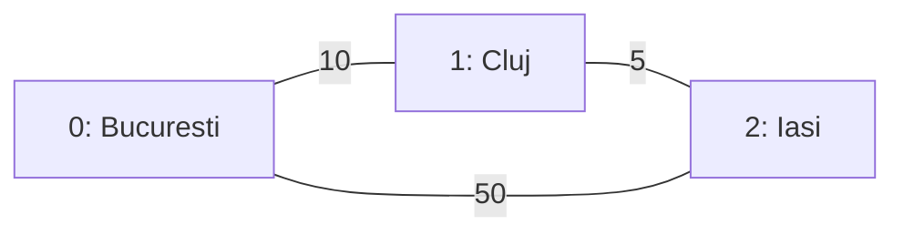

# Network Routing and Failover Simulator

A C++17 command-line simulator for shortest-path routing, reversible network failures, and minimum spanning forests.

The project represents routers and cables as an undirected, weighted graph. It uses **Dijkstra's algorithm** to find a minimum-cost route and **Prim's algorithm** to compute a minimum spanning forest over the active network. An interactive menu lets users disable and restore routers or cables, inspect the resulting topology, and calculate routes again.

The implementation brings together object-oriented design, adjacency lists, priority queues, graph algorithms, file parsing, exception handling, and timestamped event logging.

> **Execution model:** a failure changes the network's stored state. The next routing or spanning-forest request uses that updated state. The simulator operates on an in-memory graph; it does not forward real packets or implement an OSPF, STP, or SDN control protocol.

## Contents

- [Features](#features)
- [Repository layout](#repository-layout)
- [Build and run](#build-and-run)
- [Topology file format](#topology-file-format)
- [Interactive interface](#interactive-interface)
- [Failover demonstration](#failover-demonstration)
- [Algorithms and complexity](#algorithms-and-complexity)
- [Code architecture](#code-architecture)
- [Event logging](#event-logging)
- [Validation and error handling](#validation-and-error-handling)
- [Verification scenarios](#verification-scenarios)
- [Current limitations](#current-limitations)
- [Possible extensions](#possible-extensions)

## Features

- Load a network topology from a local text file.
- Display router names, router states, cable costs, and cable states.
- Calculate a minimum-cost route between two online routers.
- Disable and restore individual routers without deleting their connections.
- Disable and restore an undirected cable in both adjacency lists.
- Find an alternative route after a failure, when one exists.
- Report unreachable destinations and disconnected active components.
- Compute a minimum spanning forest, including isolated online routers.
- Append network-loading and state-change events to a timestamped log.
- Recover from common interactive input errors and report invalid operations.
- Run a standalone suite of 35 network checks and a scripted menu demonstration.

## Repository layout

The application source files and initial topology are kept in `src/`.

| Path | Responsibility |
| --- | --- |
| `README.md` | Project documentation and reproducible usage examples. |
| `CMakeLists.txt` | Optional CMake build configuration and CTest registration for the automated checks. |
| `src/main.cpp` | Interactive menu, input recovery, result formatting, and event logging. |
| `src/Router.h` | Declaration of the `Router` class. |
| `src/Router.cpp` | Router name and online/offline state management. |
| `src/Network.h` | Network interface and the `Link`, `Route`, `TreeLink`, and `SpanningForest` structures. |
| `src/Network.cpp` | Graph storage operations, topology loading, failure handling, Dijkstra, and Prim. |
| `src/network.txt` | Initial topology loaded at startup. |
| `src/events.log` | Runtime log, created or appended to when the application runs from `src/`. |
| `data/topology.txt` | Three-router topology loaded by the automated tests; uses the same format as `src/network.txt`. |
| `data/failover.txt` | Numeric menu responses for a repeatable failover demonstration. |
| `tests/network_tests.cpp` | Standalone automated checks for the public `Network` interface. |
| `tests/fixtures/invalid.txt` | A topology referencing router `9` after declaring only one router. |
| `tests/fixtures/empty.txt` | An empty file used to verify rejection of an empty topology. |
| `build/` | Generated test executables and other local build outputs. |

Executables and `events.log` are generated artifacts. Exclude them and `/build/` through `.gitignore`; keep the source files, `data/`, and `tests/` in source control.

## Build and run

### Requirements

- A C++17-capable compiler, such as GCC/G++.
- A terminal. On Windows, the commands below use PowerShell and assume `g++` is available on `PATH`, for example through a MinGW-w64 installation.
- The five C++ source/header files and `network.txt` in `src/`.

The project uses the C++ standard library and requires no third-party C++ dependencies.

### Windows / PowerShell

From the project root, enter the source directory and compile:

```powershell
cd src
g++ -std=c++17 -Wall -Wextra -pedantic main.cpp Network.cpp Router.cpp -o simulator.exe
```

After a successful compilation, run:

```powershell
.\simulator.exe
```

### Linux / Bash

From the project root, enter the source directory and compile:

```bash
cd src
g++ -std=c++17 -Wall -Wextra -pedantic main.cpp Network.cpp Router.cpp -o simulator
```

After a successful compilation, run:

```bash
./simulator
```

### Working directory and rebuilds

`main.cpp` opens `network.txt` and `events.log` using relative paths. Both paths are resolved against the terminal's **current working directory**, not automatically against the executable's location. Run the simulator from `src/` with the layout above.

Save and recompile after changing C++ code. Running an existing executable does not compile the edited source files; if compilation fails, an older executable may still be present. Changes to `network.txt` require a restart, but do not require recompilation.

### Optional CMake build and CTest

The manual compiler commands above are sufficient. CMake provides another way to build the simulator and its test executable together. It requires CMake 3.16 or later, a C++17 compiler, and a compatible build tool.

For **Windows / PowerShell with MinGW**, ensure `cmake`, `g++`, and `mingw32-make` are on `PATH`. From the project root:

```powershell
cmake -S . -B build -G "MinGW Makefiles"
cmake --build build
```

After a successful build:

```powershell
cd build
ctest --output-on-failure
.\sdn-simulator.exe
```

For **Linux / Bash with GCC and Make**, from the project root:

```bash
cmake -S . -B build
cmake --build build
```

After a successful build:

```bash
cd build
ctest --output-on-failure
./sdn-simulator
```

CTest registers **one test executable**, `network-tests`, which performs the **35 checks** described below. The numeric failover demonstration is a separate input script; it is not registered as a CTest test. The simulator has no `--demo` or `--log` command-line options.

CMake copies `src/network.txt` to `build/network.txt` during configuration. When following these commands, the application reads that copy and writes `build/events.log`, because the current directory is `build/`. To change the initial topology, edit `src/network.txt` and rerun configuration/build before restarting.

The working directory remains important: launching `build/sdn-simulator` while staying in the project root does not make the application look for files inside `build/`.

## Topology file format

The loader reads whitespace-separated values in this order:

1. A positive integer `N`: the number of routers.
2. Exactly `N` router names, each represented by one token.
3. A non-negative integer `M`: the number of undirected cables.
4. Exactly `M` cable records, each containing `source destination cost`.

The supplied example is:

```text
3
Bucuresti
Cluj
Iasi
3
0 1 10
1 2 5
0 2 50
```

Router indices are assigned by name order:

| Index | Router |
| --- | --- |
| `0` | Bucuresti |
| `1` | Cluj |
| `2` | Iasi |



Each cable record describes a bidirectional connection. For example, `0 1 10` creates both the `0 -> 1` and `1 -> 0` adjacency-list entries. List each physical cable once in the file.

**Format rules:**

- Router indices must be between `0` and `N - 1`.
- Cable costs must be non-negative integers; zero-cost cables are allowed.
- Costs are user-defined weights. They can represent a simplified latency estimate, but the simulator does not measure actual network latency.
- Names cannot contain whitespace. Use a single token such as `Bucuresti_Core` for a multiword label.
- Use plain numeric tokens and the declared number of records. Comments and extra records are not part of the format.
- All routers and cables start online. The file format does not contain status fields.

For the example topology, the initial route from `0` to `2` is `0 -> 1 -> 2`, with total cost `10 + 5 = 15`. The direct cable has cost `50` and provides an alternative when the cheaper path becomes unavailable.

## Interactive interface

At startup, the program loads `network.txt` and displays:

```text
--- Network Simulator ---
1. Display the network
2. Calculate a route
3. Change router status
4. Change cable status
5. Calculate the minimum spanning forest
0. Exit
Choose an option:
```

Enter the option number first. When prompted, enter its parameters, separated by spaces or newlines.

| Option | Parameters | Example response | Result |
| --- | --- | --- | --- |
| `1` | None | — | Print every router and its stored connections, including offline objects. |
| `2` | `source destination` | `0 2` | Calculate and print a route using the current active topology. |
| `3` | `router_index status` | `1 0` | Set a router offline or online. |
| `4` | `source destination status` | `0 1 0` | Set the cable between the endpoints offline or online. |
| `5` | None | — | Print the minimum spanning forest, its total cost, and its component count. |
| `0` | None | — | Log a normal shutdown and exit. |

For both state-changing options, `0` means **OFFLINE** and `1` means **ONLINE**.

Router state and cable state are independent. Turning a router off makes it unavailable to the algorithms, but preserves its incident cables and their individual states. Turning it back on does not repair a cable that was separately disabled.

Option `1` reports these states separately. A cable can therefore be displayed as `ONLINE` while one of its endpoint routers is `OFFLINE`; that connection is still unusable for routing.

## Failover demonstration

Use the supplied three-router topology and start a fresh simulator session. Follow the rows below **in order**. In the input column, each comma separates a response followed by Enter; do not type the commas.

| Step | Inputs in order | Expected route from `0` to `2` |
| --- | --- | --- |
| Establish the baseline | `2`, `0 2` | `0 -> 1 -> 2`, cost `15`. |
| Take Cluj offline | `3`, `1 0`, `2`, `0 2` | `0 -> 2`, cost `50`. |
| Restore Cluj | `3`, `1 1`, `2`, `0 2` | `0 -> 1 -> 2`, cost `15`. |
| Disable the Bucuresti–Cluj cable | `4`, `0 1 0`, `2`, `0 2` | `0 -> 2`, cost `50`. |
| Restore that cable | `4`, `0 1 1`, `2`, `0 2` | `0 -> 1 -> 2`, cost `15`. |
| Isolate Bucuresti by disabling both incident cables | `4`, `0 1 0`, `4`, `0 2 0`, `2`, `0 2` | `No route available.` |
| Restore both cables | `4`, `0 1 1`, `4`, `0 2 1`, `2`, `0 2` | `0 -> 1 -> 2`, cost `15`. |

A successful baseline query prints:

```text
Minimum cost: 15
Path: 0 -> 1 -> 2
```

After disabling either Cluj or the Bucuresti–Cluj cable, the next query prints:

```text
Minimum cost: 50
Path: 0 -> 2
```

These cases demonstrate route recomputation after a failure and recovery after restoration. A state change alone does not print a new route: select option `2` to request it.

### Inspecting connectivity with Prim

Option `5` answers a different question: what is the minimum-total-cost set of cables that connects each active component without cycles?

For each row below, start from the original topology with all routers online:

| Cable configuration | Selected undirected edges | Total cost | Components |
| --- | --- | --- | --- |
| All cables online | `0–1`, `1–2` | `15` | `1` |
| Only `0–1` disabled | `0–2`, `1–2` | `55` | `1` |
| Both `0–1` and `0–2` disabled | `1–2`; router `0` is isolated | `5` | `2` |

Prim reports its selected edges without changing cable states. Calculating a forest does not restrict subsequent Dijkstra queries to those edges.

## Algorithms and complexity

### Dijkstra: minimum-cost routing

Implemented in `Network::shortestPath(source, destination)`.

The algorithm minimizes the **sum of cable costs**, rather than the number of hops.

1. Validate the source and destination indices. If either endpoint is offline, return an unreachable result.
2. Initialize distances to an infinity sentinel and set the source distance to zero.
3. Use a min-priority queue of `(accumulated_cost, router_index)` entries.
4. Discard stale queue entries whose costs no longer match the best recorded distance.
5. Examine usable connections and update a neighbor only when a strictly cheaper route is found.
6. Store predecessor indices and reconstruct the result from destination to source, then reverse the path.

A connection is usable only when its cable and both endpoint routers are online. Non-negative cable costs are enforced when links are added. Individual costs use `int`; accumulated route costs use `long long`.

`Route::reachable` distinguishes an unreachable destination from a valid zero-cost route. Requesting a route from an online router to itself returns that router with cost `0`.

### Prim: minimum spanning forest

Implemented in `Network::minimumSpanningForest()`.

The algorithm minimizes the **total weight of the selected connecting edges** in each active component.

1. Keep track of routers already included in the forest.
2. Start a new Prim traversal at every online router that has not yet been included.
3. Use a min-priority queue of `(edge_cost, source, destination)` candidates.
4. Add a candidate edge only when it reaches a router not yet included.
5. Ignore offline cables and offline routers.
6. Accumulate selected edges, total cost, and the number of active components.

A disconnected network produces a forest rather than a single tree. An isolated online router counts as one component with no selected edges. If every router is offline, the forest has cost `0` and `0` components.

For `A` online routers and `C` active components, the forest contains `A - C` edges. Offline routers are excluded from both counts.

### Complexity of this implementation

Let `V` be the number of stored routers and `E` the number of undirected cable records. Each cable is stored twice in the adjacency lists, which does not change the asymptotic bounds.

| Operation | Worst-case time | Additional working space |
| --- | --- | --- |
| Dijkstra query | `O(V + E log(E + 1))` | `O(V + E)` |
| Prim forest computation | `O(V + E log(E + 1))` | `O(V + E)` |
| Change router status | `O(1)` | `O(1)` |
| Change cable status between `u` and `v` | `O(deg(u) + deg(v))` | `O(1)` |
| Display the network | `O(V + E)` | `O(1)`, excluding formatted output |

The graph itself occupies `O(V + E)` space. The heap bounds account for the implementation's queued candidates and stale entries; it does not use an indexed decrease-key heap. For a simple graph, the algorithm bounds are also commonly expressed as `O((V + E) log V)`.

These are algorithmic bounds, not measured latency guarantees or performance benchmarks.

## Code architecture

### Responsibilities

`Router` stores a name and an online/offline flag. `Network` owns the routers and adjacency lists, enforces graph-related constraints, and implements the algorithms. `main.cpp` coordinates user commands, prints results, catches errors, and records events.

### Data structures

| Type | Fields | Meaning |
| --- | --- | --- |
| `Router` | `name`, `isOnline` | One router and its current availability. |
| `Link` | `destination`, `cost`, `isOnline` | One directional adjacency-list entry for an undirected cable. |
| `Route` | `reachable`, `cost`, `path` | The outcome of a shortest-path query. |
| `TreeLink` | `source`, `destination`, `cost` | One selected forest edge. |
| `SpanningForest` | `links`, `cost`, `components` | The selected forest and its aggregate information. |

`Network` stores `std::vector<Router>` and `std::vector<std::vector<Link>>` as private members. Callers interact with public methods rather than modifying the adjacency lists directly.

### Main network operations

| Method | Contract |
| --- | --- |
| `addRouter(name)` | Append an online router and an empty adjacency list. |
| `addLink(source, destination, cost)` | Validate endpoints and cost, then insert both directional entries. |
| `loadFromFile(filename)` | Build a temporary network and replace the current graph after the required records have been read successfully. |
| `printNetwork()` | Print stored topology and separate router/cable states. |
| `shortestPath(source, destination)` | Return a `Route` using the current active topology. |
| `setRouterStatus(id, online)` | Change router availability while preserving its connections. |
| `setLinkStatus(source, destination, online)` | Update matching cable entries in both directions; reject an absent connection. |
| `minimumSpanningForest()` | Return a forest over all online routers and usable cables. |

The two algorithm methods are `const`: computing a result does not change the network state. When `Route::reachable` is `false`, its default cost must not be interpreted as the cost of a valid path.

Building a temporary network during file loading also preserves the previous graph if an exception occurs before the final swap.

## Event logging

`main.cpp` appends events to `events.log` in the current working directory. Each entry contains the machine's local date and time:

```text
[2026-10-17 19:00:00] Network loaded from network.txt.
[2026-10-17 19:00:10] Router 1 set OFFLINE
[2026-10-17 19:00:20] Router 1 set ONLINE
[2026-10-17 19:00:30] Link 0-1 set OFFLINE
[2026-10-17 19:00:40] Link 0-1 set ONLINE
[2026-10-17 19:00:50] Simulator closed.
```

The timestamps above are illustrative. Logged events include successful startup loading, accepted router/cable status commands, and normal shutdown through option `0`.

The file is opened in append mode, so previous sessions are preserved. Route and forest queries are printed to the terminal and are not recorded as log events. Logging failures produce a warning; they do not roll back an already completed state change.

The log is an operational history. It is not a saved network snapshot and is not replayed at startup.

## Validation and error handling

| Situation | Behavior |
| --- | --- |
| `network.txt` cannot be opened | Print an error and exit with a non-zero status. |
| Non-positive router count or negative cable count | Reject the topology. |
| Missing required router names or cable fields | Reject the topology when extraction fails. |
| Router index outside the valid range | Throw `std::out_of_range`; an interactive command reports the error and returns to the menu. |
| Negative cable cost | Throw `std::invalid_argument` while building the graph. |
| Status command for an absent cable | Report `Link does not exist.` and return to the menu. |
| Status other than `0` or `1` | Reject the command without changing the requested state. |
| Numeric input extraction fails | Clear recoverable stream errors, discard the remainder of the input line, and prompt again. |
| Source/destination offline or disconnected | Return an unreachable result and print `No route available.` |
| Log cannot be opened or written | Print a warning and allow the simulator to continue. |

An unavailable route is an expected simulation outcome, not a fatal program error. The menu can still be used to restore connectivity.

Input follows the whitespace-delimited format described above. This is a compact parser rather than a general configuration language; use complete integer tokens and avoid annotations or additional fields in the topology file.

## Verification scenarios

The implementation and standalone test program have been compiled with `-std=c++17 -Wall -Wextra -pedantic`. The automated suite checks the network classes, while the scripted demonstration exercises the interactive application. No CI configuration or separate test framework is required for the commands below.

### Run the automated checks

`tests/network_tests.cpp` runs **35 checks** covering routes in both directions, offline endpoints, cable restoration, disconnected forests, invalid indices and costs, failed file loading, preservation of an existing topology, zero-cost cycles, and accumulated costs larger than a 32-bit integer.

The test program has its own `main()` function. Compile it with `Network.cpp` and `Router.cpp`, separately from the application's `src/main.cpp`.

From the **project root**, on Windows / PowerShell:

```powershell
New-Item -ItemType Directory -Force build | Out-Null
g++ -std=c++17 -Wall -Wextra -pedantic -Isrc tests/network_tests.cpp src/Network.cpp src/Router.cpp -o build/network-tests.exe
```

After a successful compilation:

```powershell
.\build\network-tests.exe .
```

From the **project root**, on Linux / Bash:

```bash
mkdir -p build
g++ -std=c++17 -Wall -Wextra -pedantic -Isrc tests/network_tests.cpp src/Network.cpp src/Router.cpp -o build/network-tests
```

After a successful compilation:

```bash
./build/network-tests .
```

`-Isrc` tells the compiler where to find `Network.h`. The final `.` passed to the test executable identifies the project root, from which the program locates `data/topology.txt` and `tests/fixtures/`.

Expected successful output:

```text
Passed 35 checks.
```

A failed check prints `FAILED: ...` and exits with status `1`. The suite intentionally tries to open `tests/fixtures/nonexistent.txt`; that file must remain absent for the missing-file check.

The checks target the existing public API. They do not require a router getter or impose additional rules against duplicate names, parallel cables, or self-links.

### Run the scripted failover demonstration

`data/failover.txt` contains numeric responses for the current interactive menu. It displays the network, requests routes and forests, changes router and cable states, restores connectivity, and exits.

Before running it, build the simulator using the instructions above and ensure `src/network.txt` contains the supplied three-router topology. Its contents should match `data/topology.txt`. The application continues to load `src/network.txt` when launched from `src/`; the demonstration file supplies menu input, not the topology.

From the **project root**, on Windows / PowerShell:

```powershell
cd src
Get-Content ..\data\failover.txt | .\simulator.exe
```

From the **project root**, on Linux / Bash:

```bash
cd src
./simulator < ../data/failover.txt
```

The route results, in order, are `15`, `50`, `15`, `50`, unreachable, `15`, and `15`. The three forest results have `(cost, components)` values of `(15, 1)`, `(50, 1)`, and `(10, 2)`. Six successful state commands are appended to `events.log`, in addition to startup and normal shutdown.

The demonstration supplies a new route request after each state change. It does not add background recalculation to the simulator. Unlike the test executable, this input script does not assert that the printed results are correct; compare its output with the expected values above.

### Three-router and boundary checks

| Scenario | Expected result |
| --- | --- |
| Original topology, route `0 -> 2` | Path `0 -> 1 -> 2`, cost `15`. |
| Router `1` offline, then restored | Route cost changes from `50` back to `15`. |
| Cable `0–1` offline | Routes `0 -> 2` and `2 -> 0` both use the direct cable at cost `50`. |
| Both cables incident to router `0` offline | No route to `2`; forest cost `5`, components `2`. |
| All routers offline | Empty forest, total cost `0`, components `0`. |
| One online router and no cables | Route to itself has cost `0`; forest has one component. |
| Zero-cost cable | Accepted and considered by both algorithms. |
| Two consecutive cables, each costing `2147483647` | Accumulated route and forest costs are `4294967294`. |
| Invalid router index or negative cable cost | Report the relevant validation error. |
| Valid router/cable state command | Append the corresponding event to `events.log`. |

### Larger topology

To reproduce a larger case, keep a copy of the original `network.txt`, replace its contents with the following topology, and restart the application:

```text
6
A
B
C
D
E
F
9
0 1 4
0 2 2
1 2 1
1 3 5
2 3 8
2 4 11
3 4 2
3 5 6
4 5 3
```

Start a fresh session for each row. Use option `2` with `0 5` to inspect the route and option `5` to inspect the forest.

| Configuration | Route from `0` to `5` | Route cost | Forest cost | Components |
| --- | --- | --- | --- | --- |
| All online | `0 -> 2 -> 1 -> 3 -> 4 -> 5` | `13` | `13` | `1` |
| Cable `1–3` offline | `0 -> 2 -> 3 -> 4 -> 5` | `15` | `16` | `1` |
| Router `3` offline | `0 -> 2 -> 4 -> 5` | `16` | `17` | `1` |
| Cables `3–5` and `4–5` offline | Unreachable | — | `10` | `2` |

The second and third rows also show why shortest-path cost and minimum-forest cost are different quantities.

### Troubleshooting

| Symptom | What to check |
| --- | --- |
| `g++` is not recognized | Confirm the compiler is installed and available on `PATH`. |
| `Could not open network file.` | Check the current directory and the exact filename `network.txt`, including its extension. |
| Source edits do not change the output | Save all edited files, rebuild successfully, and run the newly built executable. |
| A state change does not print a new route | Select option `2` and enter the source/destination again. |
| The cheaper route does not return after a router is restored | Check whether a cable on that route is still offline. |
| Prim prints more than one component | The online routers are disconnected through the currently usable cables. |
| Recent log entries seem to be missing | Check the `events.log` in the program's working directory and look for logging warnings. |

## Current limitations

- **Simulation scope:** the application models graph state and algorithm results. It does not exchange routing-protocol messages, configure network devices, or simulate live traffic.
- **On-demand computation:** routes and forests are computed when their menu options are selected. There is no background monitoring, automatic failure detection, or continuously updated routing table.
- **No failover timing guarantee:** packet loss, convergence delay, and uninterrupted sessions are outside the model.
- **Static weights:** costs are integer values from the topology file; they do not change with congestion or real measurements.
- **Independent analysis tools:** Prim returns a forest for inspection. It does not disable redundant cables or implement STP behavior.
- **Session-local state:** router and cable changes are held in memory. Restarting reloads the topology with every object online; the event log does not restore prior states.
- **Endpoint-based cable control:** cables have no separate identifiers. If parallel entries connect the same endpoints, `setLinkStatus` changes all matching entries.
- **Graph construction rules:** the current `Network` API does not enforce unique router names or reject self-links. Router identity is determined by its index.
- **Compact input format:** router names are single tokens, the filename is fixed in `main.cpp`, and the application has no interactive topology reload command.
- **Permissive numeric parsing:** formatted integer input can accept a numeric prefix such as `0` from `0abc`; the topology loader does not reject trailing tokens after the declared records. Strict whole-token validation is a future improvement.

## Possible extensions

These are future development ideas, not implemented features:

- Run the existing CMake/CTest checks automatically in continuous integration.
- Add strict configuration parsing and a versioned format for saved topology and state.
- Support topology reloads and timed failure/recovery scenarios.
- Add an optional observer that recalculates selected routes after state changes.
- Visualize the graph, selected path, and spanning forest.
- Measure runtime on larger generated graphs and publish reproducible benchmarks.

## Author

**Alexandru Cujba**

Developed as a learning and portfolio project in C++ object-oriented programming, graph algorithms, and networking fundamentals.
